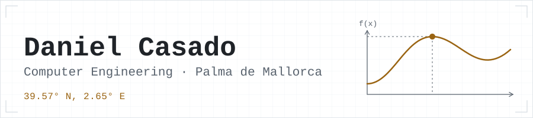

<a href="README.md">English</a> · <b>Español</b>

<picture>
  <source media="(prefers-color-scheme: dark)" srcset="assets/banner-dark.svg">
  <source media="(prefers-color-scheme: light)" srcset="assets/banner-light.svg">
  
</picture>

Estudio Ingeniería Informática en la Universitat de les Illes Balears y doy clases particulares de matemáticas en Palma de Mallorca.
Hago herramientas que usaría yo mismo, y algún experimento raro, como controlar un editor guiñando un ojo.

## Proyectos destacados

> ### [STEP-BY-STEP LD](https://stepbystepld.danicaju.workers.dev/)
> Una calculadora científica que muestra cada paso de la solución, con un escáner para ejercicios en papel.
> Funciona en Windows, macOS, Linux y web. Android está en pruebas cerradas.
>
> `Flutter` `Cloudflare Workers` `Escritorio / Web / Android`
>
> [Web](https://stepbystepld.danicaju.workers.dev/) · [Descargas](https://github.com/danicaju/stepbystepld-releases)

| Proyecto | Qué hace | Stack |
| :-- | :-- | :-- |
| [IDEye](https://github.com/danicaju/IDEye) | Controla un editor con la webcam, mediante estimación de la mirada y gestos faciales como guiños. | `Python` `OpenCV` `MediaPipe` `PyQt6` |
| [danicaju.github.io](https://github.com/danicaju/danicaju.github.io) | Lecciones y ejercicios de matemáticas para ESO y Bachillerato, que uso en mis clases. | `HTML` `CSS` `JavaScript` |
| [RealTimeChat](https://github.com/danicaju/RealTimeChat) | Servidor y cliente de chat sobre sockets TCP, con protocolo JSON y un pool de hilos. | `Java 17` |

## Herramientas

- Lenguajes: `Dart` `Python` `TypeScript` `C` `Java` `SQL` `Lua`
- Frameworks e interfaces: `Flutter` `React` `Qt`
- Infraestructura: `Cloudflare Workers` `Cloudflare Pages` `GitHub Actions` `Supabase` `Git` `Linux` `LaTeX`

[Web](https://danicaju.github.io) · [STEP-BY-STEP LD](https://stepbystepld.danicaju.workers.dev/) · [Correo](mailto:danicaju20@gmail.com)
