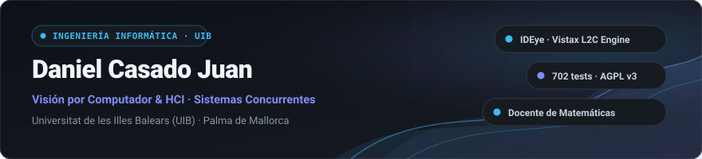

  <a href="README.md">English</a> &middot; <b>Español</b>

  

Estudiante de 3º de **Ingeniería Informática** en la [Universitat de les Illes Balears (UIB)](https://www.uib.cat/). Especial interés en **visión por computador**, **interacción persona-ordenador (HCI)** y **arquitectura de sistemas concurrentes**.

Compagino mis estudios de ingeniería con la docencia personalizada de **matemáticas para ESO y Bachillerato** en Palma de Mallorca.

  
  &nbsp;
  
  &nbsp;
  

---

### 👁️ Proyecto Destacado: [IDEye (Vistax L2C Engine)](https://github.com/danicaju/IDEye)

> **Look-To-Code (L2C) Engine:** Sistema de control visual para desarrollo de software manos libres y en silencio mediante visión artificial sobre cámara web convencional.

<table>
  <tr>
    <td width="50%" valign="top">
      <h4>📷 Hardware Accesible &amp; Visión Artificial</h4>
      <ul>
        <li><b>Sensor Convencional:</b> Opera con cualquier cámara web estándar (<b>$0</b> en hardware adicional, sin sensores infrarrojos ni periféricos propietarios).</li>
        <li><b>Pipeline Visual:</b> MediaPipe FaceMesh (478 puntos de referencia) y OpenCV para estimación híbrida de la mirada en tiempo real.</li>
        <li><b>Operación Silenciosa:</b> Disparadores por microgestos faciales discretos (guiños diferenciados y apertura bucal); sin depender de comandos por voz ni captación de audio.</li>
      </ul>
    </td>
    <td width="50%" valign="top">
      <h4>🖥️ Integración de Entorno &amp; Robustez</h4>
      <ul>
        <li><b>HUD 3×3 Flotante:</b> Interfaz gráfica no intrusiva desarrollada en PyQt6 con flags nativos <i>no-focus</i> para evitar sustraer el foco del editor activo.</li>
        <li><b>Extensión VS Code:</b> Extensión complementaria conectada en tiempo real vía WebSocket (<code>ideye-vscode-bridge-0.5.0.vsix</code>).</li>
        <li><b>Calidad de Código:</b> <b>702 tests automatizados</b> en pytest.</li>
        <li><b>Licencia:</b> GNU AGPL v3 (software libre).</li>
      </ul>
    </td>
  </tr>
</table>

  <a href="https://github.com/danicaju/IDEye"><b>Ver Código en GitHub</b></a> &middot;
  <a href="https://github.com/danicaju/IDEye/tree/main/vscode-extension"><b>Extensión VS Code</b></a> &middot;
  <a href="https://github.com/danicaju/IDEye/releases"><b>Descargar v0.5.0</b></a> &middot;
  <a href="https://github.com/danicaju/IDEye/blob/main/LICENSE"><b>Licencia AGPL v3</b></a>

---

### 🛠️ Stack Tecnológico

  
  &nbsp;&nbsp;&nbsp;&nbsp;
  
  &nbsp;&nbsp;&nbsp;&nbsp;
  

| Área | Tecnologías, Protocolos &amp; Herramientas |
| :--- | :--- |
| **Lenguajes** | `Python 3.10+` &middot; `Java` &middot; `C` &middot; `Bash` &middot; `Ensamblador Motorola 68000 (M68k)` |
| **Visión por Computador e Interfaces** | `OpenCV` &middot; `MediaPipe (FaceMesh 478)` &middot; `PyQt6 (GUI no-focus)` &middot; `NumPy` |
| **Redes y Concurrencia** | `Sockets TCP/IP` &middot; `WebSockets (Real-Time)` &middot; `Multithreading` &middot; `Sincronización y Exclusión Mutua` |
| **Sistemas y Herramientas** | `Linux` &middot; `Git` &middot; `GitHub` &middot; `VS Code` &middot; `Pytest` &middot; `GCC / Make` |

---

### 📂 Otros Proyectos

| Proyecto | Enfoque Técnico | Stack |
| :--- | :--- | :--- |
| [**RealTimeChat**](https://github.com/danicaju/RealTimeChat) | Arquitectura cliente-servidor multihilo basada en sockets TCP/IP para mensajería bidireccional en tiempo real con gestión concurrente de conexiones. | `Java` `Sockets TCP/IP` `Multithreading` |
| [**Big-O-Runtime-Estimator**](https://github.com/danicaju/Big-O-Runtime-Estimator) | Medición empírica y contrastación de complejidad algorítmica asintótica con interfaces CLI y gráfica en Swing. | `Java` `Swing` `Algoritmia` |
| [**MC68000-Practice**](https://github.com/danicaju/MC68000-Peripheral-Access-Practice) | Programación a bajo nivel para control de periféricos con puertos E/S mapeados en memoria y rutinas de servicio de interrupciones (ISR). | `Assembly M68k` `Bajo Nivel` `Hardware` |

---

### 🎓 Formación &amp; Idiomas

- **Grado en Ingeniería Informática** (3º curso) — [Universitat de les Illes Balears (UIB)](https://www.uib.cat/)
- **Docencia:** Clases particulares de matemáticas para Educación Secundaria (ESO) y Bachillerato en Palma de Mallorca ([danicaju.github.io](https://danicaju.github.io)).
- **Idiomas:**
  - **Español y Catalán:** Nativo / Materno
  - **Inglés:** C1 (lectura técnica fluida y redacción profesional)
  - **Alemán:** A2 (competencia básica)

---

### 📊 Actividad en GitHub

  
  &nbsp;&nbsp;
  

