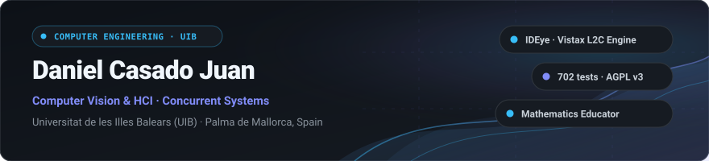

  <b>English</b> | <a href="README.es.md">Español</a>

  

3rd-year **Computer Engineering** undergraduate at [Universitat de les Illes Balears (UIB)](https://www.uib.cat/). Focused on **computer vision**, **human-computer interaction (HCI)**, and **concurrent systems architecture**.

Alongside engineering coursework, I work as a private **mathematics tutor** for secondary and high school students in Palma de Mallorca.

  
  &nbsp;
  
  &nbsp;
  

---

### 👁️ Featured Project: [IDEye (Vistax L2C Engine)](https://github.com/danicaju/IDEye)

> **Look-To-Code (L2C) Engine:** Vision-based control system for hands-free and completely silent software development using a standard webcam.

<table>
  <tr>
    <td width="50%" valign="top">
      <h4>📷 Accessible Hardware &amp; Vision Pipeline</h4>
      <ul>
        <li><b>Commodity Sensor:</b> Runs on any standard webcam (<b>$0</b> extra hardware cost, zero infrared sensors or proprietary eye trackers required).</li>
        <li><b>Vision Pipeline:</b> MediaPipe FaceMesh (478 facial landmarks) and OpenCV for hybrid real-time gaze estimation.</li>
        <li><b>Silent Operation:</b> Discrete facial microgesture triggers (independent winks and mouth opening) without voice commands or audio capture.</li>
      </ul>
    </td>
    <td width="50%" valign="top">
      <h4>🖥️ Environment Integration &amp; Engineering</h4>
      <ul>
        <li><b>Floating 3×3 HUD:</b> Non-intrusive PyQt6 overlay engineered with native <i>no-focus</i> flags to prevent stealing window focus from the active editor.</li>
        <li><b>VS Code Companion:</b> Real-time WebSocket connection to an editor extension (<code>ideye-vscode-bridge-0.5.0.vsix</code>).</li>
        <li><b>Code Quality:</b> <b>702 automated tests</b> passing in pytest.</li>
        <li><b>License:</b> GNU AGPL v3 (copyleft open source).</li>
      </ul>
    </td>
  </tr>
</table>

  <a href="https://github.com/danicaju/IDEye"><b>Source Code</b></a> |
  <a href="https://github.com/danicaju/IDEye/tree/main/vscode-extension"><b>VS Code Extension</b></a> |
  <a href="https://github.com/danicaju/IDEye/releases"><b>Download v0.5.0</b></a> |
  <a href="https://github.com/danicaju/IDEye/blob/main/LICENSE"><b>AGPL v3 License</b></a>

---

### 🛠️ Technical Stack

  
  &nbsp;&nbsp;&nbsp;&nbsp;
  
  &nbsp;&nbsp;&nbsp;&nbsp;
  

| Area | Technologies, Protocols &amp; Tools |
| :--- | :--- |
| **Languages** | `Python 3.10+` | `Java` | `C` | `Bash` | `Motorola 68000 Assembly (M68k)` |
| **Computer Vision &amp; Interfaces** | `OpenCV` | `MediaPipe (FaceMesh 478)` | `PyQt6 (No-Focus GUI)` | `NumPy` |
| **Networking &amp; Concurrency** | `TCP/IP Sockets` | `WebSockets (Real-Time)` | `Multithreading` | `Synchronization &amp; Mutual Exclusion` |
| **Systems &amp; Tooling** | `Linux` | `Git` | `GitHub` | `VS Code` | `Pytest` | `GCC / Make` |

---

### 📂 Other Projects

| Project | Technical Focus | Core Stack |
| :--- | :--- | :--- |
| [**RealTimeChat**](https://github.com/danicaju/RealTimeChat) | Real-time client-server messaging platform in Java 17, TCP sockets, JSON protocol, Thread Pool concurrency, and FlatLaf Dark GUI. | `Java 17` `TCP Sockets` `FlatLaf` `Thread Pool` |
| [**Big-O-Runtime-Estimator**](https://github.com/danicaju/Big-O-Runtime-Estimator) | Scientific time complexity estimator in Java 17 with arbitrary-precision arithmetic, Ramanujan/Stirling asymptotics, and FlatLaf Dark GUI. | `Java 17` `Arbitrary-Precision` `Algorithms` `FlatLaf` |
| [**MC68000-Practice**](https://github.com/danicaju/MC68000-Peripheral-Access-Practice) | Low-level systems programming for hardware peripheral control via memory-mapped I/O and interrupt service routines (ISR). | `M68k Assembly` `Low-Level` `Hardware` |

---

### 🎓 Education &amp; Languages

- **B.Sc. in Computer Engineering** (3rd year) | [Universitat de les Illes Balears (UIB)](https://www.uib.cat/)
- **Educator:** Mathematics private tutor for secondary and high school students in Palma de Mallorca ([danicaju.github.io](https://danicaju.github.io)).
- **Languages:**
  - **Spanish &amp; Catalan:** Native / Bilingual
  - **English:** C1 (fluent technical reading, writing, and professional communication)
  - **German:** A2 (elementary proficiency)

---

### 📊 GitHub Activity

  
  &nbsp;&nbsp;
  

