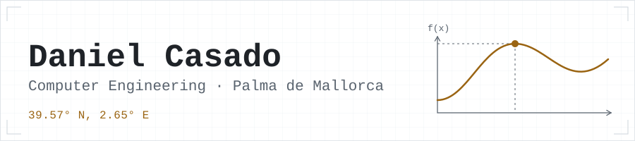

<b>English</b> · <a href="README.es.md">Español</a>

<picture>
  <source media="(prefers-color-scheme: dark)" srcset="assets/banner-dark.svg">
  <source media="(prefers-color-scheme: light)" srcset="assets/banner-light.svg">
  
</picture>

I study Computer Engineering at the Universitat de les Illes Balears and tutor math privately in Palma de Mallorca.
I build tools I would use myself, and the occasional odd experiment, like controlling an editor by winking.

## Selected projects

> ### [STEP-BY-STEP LD](https://stepbystepld.danicaju.workers.dev/)
> A scientific calculator that shows every step of a solution, with a scanner for exercises on paper.
> It runs on Windows, macOS, Linux and the web. Android is in closed testing.
>
> `Flutter` `Cloudflare Workers` `Desktop / Web / Android`
>
> [Website](https://stepbystepld.danicaju.workers.dev/) · [Downloads](https://github.com/danicaju/stepbystepld-releases)

| Project | What it does | Stack |
| :-- | :-- | :-- |
| [IDEye](https://github.com/danicaju/IDEye) | Controls an editor from a webcam, using gaze estimation and facial gestures such as winks. | `Python` `OpenCV` `MediaPipe` `PyQt6` |
| [danicaju.github.io](https://github.com/danicaju/danicaju.github.io) | Math lessons and exercises for secondary and high school students, used in my tutoring. | `HTML` `CSS` `JavaScript` |
| [RealTimeChat](https://github.com/danicaju/RealTimeChat) | Chat server and client over TCP sockets, with a JSON protocol and a thread pool. | `Java 17` |

## Tools

- Languages: `Dart` `Python` `TypeScript` `C` `Java` `SQL` `Lua`
- Frameworks and UI: `Flutter` `React` `Qt`
- Infrastructure: `Cloudflare Workers` `Cloudflare Pages` `GitHub Actions` `Supabase` `Git` `Linux` `LaTeX`

[Website](https://danicaju.github.io) · [STEP-BY-STEP LD](https://stepbystepld.danicaju.workers.dev/) · [Email](mailto:danicaju20@gmail.com)
